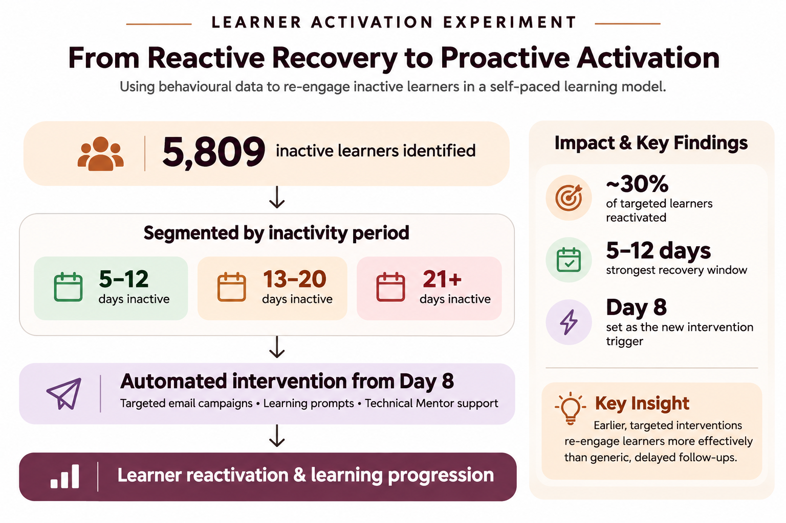

# From Reactive Recovery to Proactive Activation

### Redesigning Learner Intervention in a Self-Paced Learning Model

**Project:** Learner Activation Experiment  
**Focus:** Growth Strategy | Behavioural Analysis | Lifecycle Engagement | Experimentation

---

## 1. Project Overview

After two months of operating a self-paced learning model, learner activation remained stuck at 16% of all paid and enrolled learners.

The existing engagement approach relied on automated email nudges triggered after 21 days of inactivity. However, analysis showed that many learners had already disengaged significantly by the time these interventions reached them.

I led an activation experiment targeting 5,809 inactive learners to investigate whether earlier, more targeted intervention could improve learner reactivation.

The experiment combined segmented email campaigns, actionable learning prompts and Technical Mentor support.

**Key discovery:** Most successfully reactivated learners came from the group that had been inactive for 5–12 days.

This finding informed a change to the learner engagement process: automatically enrolling learners into the recovery campaign after 8 days of inactivity rather than waiting for the existing 21-day trigger.

## 2. The Problem

The self-paced learning model offered flexibility, allowing learners to progress through their courses independently.

However, flexibility also created a challenge: learners could disengage without an immediate intervention.

Two months after launch:

- Overall activation was stuck at 16% of paid and enrolled learners.
- A significant proportion of inactive learners had gone more than 21 days without learning activity.
- Automated engagement nudges were only triggered after 21 days of inactivity.
- By the time learners received these nudges, many had already become difficult to recover.

The existing approach was reactive rather than preventative.

We needed to understand whether intervening earlier could improve the likelihood of learners returning to their learning journeys.

## 3. The Hypothesis

We hypothesised that learners who had recently stopped engaging were more likely to resume learning than those who had been inactive for an extended period.

Specifically, we believed that:

1. Learners who had stalled between 5 and 21 days were a recoverable audience.
2. Earlier intervention would increase the likelihood of learners returning before inactivity became prolonged.
3. Combining targeted communications with access to human support would address both motivation-related and technical learning barriers.

**Our hypothesis:** Intervening earlier in the inactivity cycle, with relevant communication and targeted support, would improve learner reactivation.

## 4. Experiment Design

We designed a targeted activation campaign to test the hypothesis.

**Target audience:** 5,809 inactive learners.

Rather than treating all inactive learners as one audience, we classified learners according to the number of days since their last learning activity at the start of the campaign.

This allowed us to examine which inactivity segments were most responsive to intervention.

### Intervention components

**A. Targeted email campaigns**

We designed targeted communications to:

- Create urgency around restarting learning.
- Reduce the perceived effort required to resume.
- Give learners clear and actionable next steps.
- Encourage learners to return to their learning platforms.

**B. Technical Mentor support**

We complemented email communication with Technical Mentor sessions.

These sessions supported learners who:

- Experienced content access or technical issues.
- Needed clarification on specific course concepts.
- Required additional guidance to continue progressing.

This ensured the intervention addressed more than just learner motivation.

## 5. Execution and Analysis

The campaign reached 5,809 inactive learners.

We tracked learner reactivation and examined the inactivity duration of learners who successfully returned.

This allowed us to move beyond measuring overall campaign performance and investigate the relationship between inactivity duration and recovery.

### What the data revealed

The strongest concentration of successful reactivations came from learners who had been inactive for 5–12 days.

Learners who had been inactive for more than 12 days were significantly less likely to return.

This revealed an important behavioural insight:

**The longer a learner remained inactive, the harder it became to bring them back into the learning journey.**

The opportunity for intervention was strongest much earlier than our existing 21-day trigger.

## 6. Results and Outcomes

| Metric | Outcome |
|---|---:|
| Learners targeted | 5,809 |
| Learner reactivation rate | Approximately 30% |
| Strongest recovery segment | 5–12 days inactive |

Approximately 30% of the targeted learners reactivated during the campaign.

Beyond the overall recovery outcome, the experiment helped identify the inactivity window associated with the strongest learner response.

### Operational impact

The most significant outcome was the change to the existing engagement process.

**Before:** Learners received automated inactivity nudges after 21 days.

**After:** Learners were automatically enrolled into the targeted campaign after 8 days of inactivity.

This shifted the intervention model from waiting for prolonged disengagement to identifying and supporting inactive learners earlier.

## 7. Key Learnings

**1. Intervention timing matters.**

The findings showed that learners who had recently stalled were more responsive to recovery efforts than those with prolonged inactivity.

**2. Inactivity is not a single learner segment.**

Treating all inactive learners the same overlooks important differences in their likelihood of returning.

**3. Automation needs human support.**

Automated communication helped prompt learners to return, while Technical Mentor sessions addressed specific barriers preventing progression.

**4. Campaign insights should influence operational processes.**

The experiment did not end with campaign results. Its findings informed a permanent change to the inactivity intervention trigger.

## 8. Strategic Recommendations

Based on the experiment, the following principles should guide future learner activation efforts:

- Maintain early inactivity detection and automated intervention.
- Segment inactive learners by inactivity duration.
- Combine automated communication with relevant human support.
- Monitor reactivation by inactivity segment.
- Continuously optimise intervention timing using learner behaviour data.

## 9. Conclusion

This experiment demonstrated the value of moving from reactive learner recovery to proactive engagement.

By analysing inactivity patterns across 5,809 learners, testing targeted interventions and examining recovery behaviour, we identified an earlier opportunity to re-engage learners.

The resulting shift from a 21-day inactivity trigger to an 8-day campaign entry point transformed a campaign insight into an operational improvement.

**The central lesson: Don't wait until learners have disengaged for too long before trying to bring them back.**

---

*Note: This case study presents anonymised programme-level results. No individual learner information or confidential platform data is included.*
