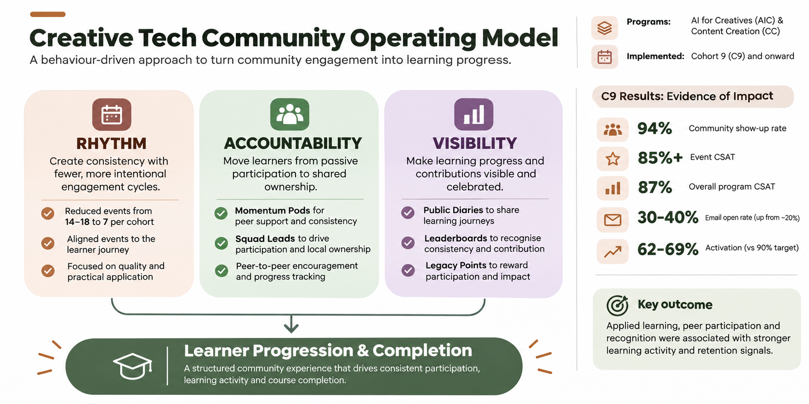

# From Activity-Based Engagement to Behaviour Design

### Designing a Community Engagement Operating Model That Drives Learner Progression

**Project:** Creative Tech Community Engagement Operating Model

**Programs:** AI for Creatives & Content Creation

**My Role:** Strategy Design & Implementation Lead

**Focus:** Community Strategy | Behaviour Design | Learner Engagement | Retention | Operating Models

---

## 1. Project Overview

I designed and led the implementation of a new community engagement operating model for ALX Creative Tech programs.

The objective was to move beyond activity-driven engagement and build a structured community experience that encouraged consistent learner participation, accountability and progression.

The previous approach relied heavily on frequent events and engagement activities. While these created opportunities for interaction, they did not consistently translate into meaningful learning progression and course completion.

To address this, I redesigned the engagement model around three pillars:

- Rhythm: Creating intentional and predictable engagement cycles.
- Accountability: Encouraging peer ownership and consistent participation.
- Visibility: Making learner progress, contributions and achievements visible.

The model was introduced from Cohort 9 and continued into subsequent cohorts.

## 2. The Challenge

The Creative Tech community had a high volume of engagement activities, including frequent events, masterclasses, community sessions and learner support initiatives.

However, activity did not necessarily translate into learning outcomes.

We identified several challenges:

- Too many events competing for learners' limited time.
- Learners participating in community activities without consistently progressing through their courses.
- Limited structures for peer accountability.
- Learner progress and achievements were not consistently visible.
- Engagement was often measured through attendance and participation rather than meaningful learning behaviours.

This created a need to rethink the purpose and structure of community engagement.

**The central question: How could we design community experiences that actively supported learner progression rather than simply increasing participation?**

## 3. The Strategic Shift

I developed a behaviour-driven engagement model built around three pillars.

### Pillar 1: Rhythm

**Objective:** Create consistency without overwhelming learners.

We reduced community events from 14–18 to 7 per cohort.

Instead of organising frequent activities, we prioritised fewer, more intentional engagement moments aligned with the learner journey.

This allowed us to focus on quality, relevance and opportunities for practical application.

### Pillar 2: Accountability

**Objective:** Move learners from passive participation to shared ownership.

We introduced:

- Momentum Pods: Small peer groups designed to encourage consistency, progress and mutual accountability.
- Squad Leads: Learner representatives who helped coordinate peer engagement, encourage participation and create local ownership.

The intention was to make learner progress a shared responsibility rather than relying entirely on program teams to drive engagement.

### Pillar 3: Visibility

**Objective:** Make learning progress and community contribution visible.

We introduced mechanisms including:

- Public Diaries: Creating opportunities for learners to document and share their progress.
- Leaderboards: Recognising consistency, participation and achievement.
- Legacy Points: Encouraging contribution and recognising learners who added value to the community.

The aim was to create visible progress, recognition and a stronger sense of belonging.

## 4. Implementation

The model was implemented across AI for Creatives and Content Creation.

Community initiatives increasingly focused on applied learning, peer collaboration, learner recognition and practical demonstrations of progress.

Rather than treating events as the primary engagement mechanism, we connected community experiences to activities that encouraged learners to apply what they were learning.

Examples included:

- Agency Briefs and collaborative projects.
- Masterclasses linked to practical learning.
- Community Jams and demonstrations.
- Peer-led engagement through Squads.
- Learner recognition and visibility initiatives.

## 5. Performance Evaluation: C9

The C9 Community Report provided an opportunity to evaluate the model through learner engagement, participation, satisfaction and learning progression signals.

### Key metrics

| Metric | C9 Outcome |
|---|---:|
| Community Show-Up Rate | 94% |
| Event CSAT | 85%+ |
| Overall Program CSAT | 87% |
| Average Masterclass Attendance | ~13% |
| Email Open Rates | 30–40% |
| Activation | 62–69% |

### What the data revealed

**1. Applied initiatives were associated with stronger learning activity.**

Content Creation submissions increased from 18.9% to 30.6% in Week 5 during the Agency Brief initiative.

Eight out of nine cities submitted.

**2. Practical learning experiences drove stronger submission activity.**

Peak weekly module submissions reached:

- AI for Creatives: 39%
- Content Creation: 44%

These peaks occurred during weeks associated with exclusive masterclasses and applied deliverables.

**3. Peer engagement showed promising retention signals.**

Learners participating in multiple community initiatives, including Agency Briefs, Masterclass Jams and Squad activities, consistently demonstrated higher weekly submission rates than their peers.

**4. Event quality was not the primary problem.**

Event satisfaction remained above 85%, even as attendance declined.

This suggested that learner capacity, competing priorities and event fatigue were important constraints.

**5. Not every intervention worked.**

Event-only catch-up interventions, including Pomodoros and Technical Mentor 1:1s, showed no measurable retention lift.

This reinforced the importance of connecting community engagement to actual learning behaviours.

## 6. Strategic Learnings

The evaluation highlighted several important principles:

- More community activities do not automatically produce better learning outcomes.
- Applied learning creates stronger opportunities for meaningful participation.
- Peer accountability can complement formal program support.
- Visible progress and recognition can encourage learner ownership.
- Community interventions should be evaluated against learner behaviour and progression, not attendance alone.

## 7. Conclusion

The Creative Tech Community Engagement Operating Model represented a shift from managing activities to intentionally designing learner behaviours.

By introducing Rhythm, Accountability and Visibility, I established a more structured approach to community engagement.

The C9 evaluation provided encouraging evidence that applied learning, peer participation and recognition were associated with stronger learning activity.

The broader lesson was that effective community strategy is not about how many activities a community delivers.

It is about designing the conditions that help people participate, progress and succeed.

---

